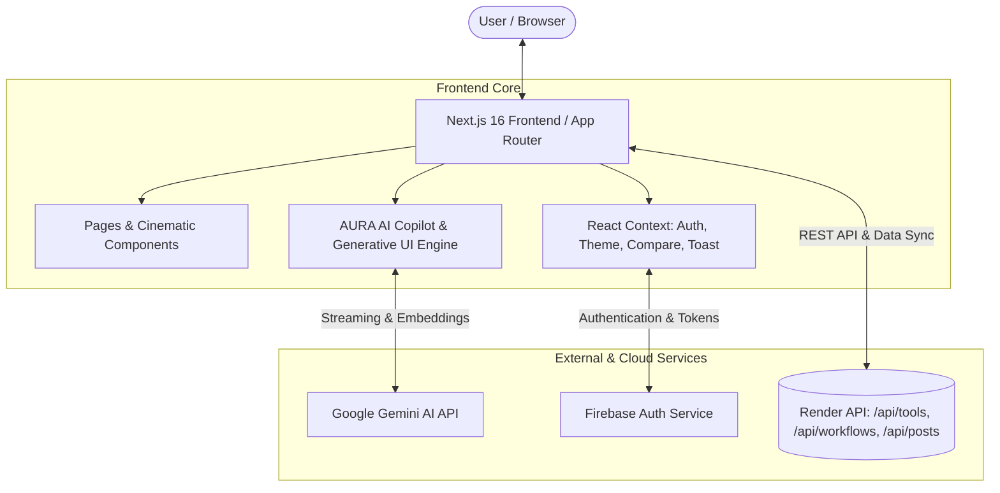

<div align="center">

# ⚡ AURA AI — AI-Powered Utility Recommendation Architecture

**The Intelligent AI Discovery Engine, Benchmark Comparator, and Automated Pipeline Builder**

[](https://nextjs.org/)
[](https://react.dev/)
[](https://www.typescriptlang.org/)
[](https://deepmind.google/technologies/gemini/)
[](https://firebase.google.com/)
[](https://gsap.com/)

<p align="center">
  <a href="#-key-features">Key Features</a> •
  <a href="#-system-architecture">Architecture</a> •
  <a href="#-tech-stack">Tech Stack</a> •
  <a href="#-project-structure">Project Structure</a> •
  <a href="#-getting-started">Getting Started</a> •
  <a href="#-generative-ui--copilot">Generative UI</a> •
  <a href="#-api--backend-integration">API Integration</a>
</p>

---

</div>

## 📌 Executive Summary

**AURA AI** (AI-Powered Utility Recommendation Platform) is a modern web application designed to help creators, developers, and businesses discover, benchmark, and deploy artificial intelligence utilities. 

With over 1,200+ curated AI tools and models, AURA bridges the gap between chaotic AI tooling and streamlined execution through **multi-step actionable workflows**, **side-by-side feature comparison docks**, and an **embedded Gemini-powered conversational copilot** featuring dynamic **Generative UI widgets**.

---

## ✨ Key Features

### 🔍 1. Curated AI Tools Directory (`/tools`)
- **400+ to 1,200+ Verified AI Tools**: Detailed profiling of top industry models and tools with category classifications, pricing models (Free, Freemium, Paid), and live website links.
- **Dynamic Search & Filtering**: Real-time multi-attribute search across categories, trending status, popularity, and user likes.
- **Deep Metrics & Badges**: Community ratings, trending tags, and category taxonomies.

### 🔄 2. Guided Generative Workflows (`/workflows`)
- **Multi-Step Execution Pipelines**: Step-by-step blueprints chaining multiple AI tools to produce end-to-end deliverables (e.g., *Automated YouTube Shorts Pipeline*, *AI-Driven SEO Content Engine*, *Full-Stack SaaS MVP Generation*).
- **Prompt Recipes**: Copy-paste ready prompts optimized for each step of the journey.
- **Difficulty & Duration Estimates**: Clear difficulty ratings (Beginner, Intermediate, Advanced) and execution times.

### ⚖️ 3. Side-by-Side Tool Comparison Engine (`/compare`)
- **Interactive Compare Dock**: Persistent, collapsible floating tray allowing users to select tools anywhere across the platform.
- **Multi-Vector Matrix**: Direct comparison of pricing, capabilities, target use cases, and feature breakdowns.

### 🤖 4. AURA AI Copilot with Generative UI (`CralyAiFab`)
- **Powered by Google Gemini**: Natural language conversational assistant for tailored tool recommendations and custom pipeline generation.
- **Generative UI Widgets**: Outputs interactive, live UI components inside chat streams:
  - 🛠️ `gen-ui:tool-recommendation`: Interactive recommendation cards.
  - 📊 `gen-ui:compare`: Side-by-side comparison tables.
  - ⚡ `gen-ui:workflow`: Multi-stage interactive execution pipelines.
- **Voice-to-Text Interaction**: Integrated speech recognition via the Web Speech API.
- **Persistent Chat History**: Session switching, local storage persistence, and exportable context.

### 👥 5. Community Feed & Prompt Exchange (`/posts`)
- **Community Creations**: User-generated posts covering prompt templates, workflow demonstrations, and tool reviews.
- **One-Click Prompt Copy**: Formatted prompt viewer with instant clipboard copying.
- **Interactive Engagement**: Nested discussion threads, likes, shares, and engagement counters.

### 🎨 6. Cinematic Glassmorphic Design System
- **Theme Support**: Seamless Dark Mode, Light Mode, and System Default theming with ultra-smooth transitions.
- **High-Performance Animations**: Kinetic hero section and staggered reveals orchestrated by **GSAP** and **Framer Motion**.
- **Responsive Layout**: Designed for mobile, tablet, and ultra-wide displays.

---

## 🏗️ System Architecture



---

## 🛠️ Tech Stack

| Domain | Technologies |
| :--- | :--- |
| **Framework** | [Next.js 16.4](https://nextjs.org/) (App Router, Server Components & Client Boundaries) |
| **Runtime & Language**| [React 19](https://react.dev/), [TypeScript 5](https://www.typescriptlang.org/) |
| **Styling** | Modern CSS Variables, Glassmorphism, Semantic Design Tokens |
| **Motion & Animation**| [GSAP 3.15](https://gsap.com/), [Framer Motion 14](https://www.framer.com/motion/) |
| **Icons** | [Lucide React](https://lucide.dev/) |
| **Authentication** | [Firebase Auth](https://firebase.google.com/) (Google OAuth & Email/Password) |
| **AI Intelligence** | [Google Gemini Flash](https://deepmind.google/technologies/gemini/) (Generative UI & Prompt Engineering) |
| **Backend REST API** | Express / Node.js Microservice deployed on [Render](https://render.com) |

---

## 📂 Project Structure

```text
craly-web/
├── public/                     # Static assets (logos, icons, brand media)
│   └── brand/                  # Official AURA AI brand imagery
├── src/
│   ├── app/                    # Next.js App Router routes
│   │   ├── categories/         # Categories directory & detail views
│   │   ├── compare/            # Side-by-side comparison matrix
│   │   ├── onboarding/         # User interest profiling & personalization
│   │   ├── posts/              # Community feed & prompt articles
│   │   ├── profile/            # User account settings & bookmarks
│   │   ├── tools/              # AI tools catalog & detail pages
│   │   ├── workflows/          # Generative AI step-by-step pipelines
│   │   ├── globals.css         # Theme tokens, variables, & utility classes
│   │   ├── layout.tsx          # Root layout with Header, Footer, Providers
│   │   └── page.tsx            # Main landing page (Hero, Trending, Showcase)
│   ├── components/             # Reusable UI components
│   │   ├── animations/         # GSAP & Framer Motion wrappers
│   │   ├── chat/               # Generative UI renderers & message cards
│   │   ├── CompareDock.tsx     # Floating multi-tool selection tray
│   │   ├── CralyAiFab.tsx      # AURA AI Floating Action Button & Assistant
│   │   ├── Header.tsx          # Navigation bar with responsive drawer & search
│   │   ├── ToolCard.tsx        # Standard AI Tool card representation
│   │   └── WorkflowCard.tsx    # Workflow timeline preview card
│   ├── config/
│   │   └── brand.ts            # Centralized brand tokens, metadata, & color palette
│   ├── context/                # Global React Context providers
│   │   ├── AuthContext.tsx     # Authentication state & JWT handling
│   │   ├── CompareContext.tsx  # Selected tools state for comparison
│   │   ├── ThemeContext.tsx    # Dark/Light theme switching
│   │   └── ToastContext.tsx    # Toast notifications
│   ├── services/               # API clients & third-party integrations
│   │   ├── api.ts              # Core backend API client & normalization
│   │   ├── chatStorage.ts      # Chat session persistence (localStorage)
│   │   ├── firebase.ts         # Firebase client SDK initialization & auth helpers
│   │   └── gemini.ts           # Google Gemini AI integration & prompt orchestration
│   └── types/                  # TypeScript interfaces and type definitions
│       └── index.ts            # Tool, Workflow, Post, User, & Message schemas
├── package.json                # Project dependencies and script declarations
└── tsconfig.json               # TypeScript compiler configuration
```

---

## 🚀 Getting Started

### Prerequisites

Ensure you have the following installed on your system:
- **Node.js**: v18.18.0 or higher (Node 20+ recommended)
- **npm**, **pnpm**, or **yarn**

### 1. Clone & Install Dependencies

Navigate to the project root directory:

```bash
cd craly-web
npm install
```

### 2. Configure Environment Variables (Optional)

By default, the application connects to the live production backend API (`https://craly-backend.onrender.com`) and standard Firebase authentication. If you wish to provide your own Gemini API key or customized API endpoint, create a `.env.local` file:

```env
# Gemini API Key (if overriding backend-provided settings)
NEXT_PUBLIC_GEMINI_API_KEY=your_gemini_api_key_here

# Backend API Endpoint (defaults to Render deployment)
NEXT_PUBLIC_API_URL=https://craly-backend.onrender.com
```

### 3. Run Development Server

```bash
npm run dev
```

Open [http://localhost:3000](http://localhost:3000) in your browser to view the application.

### 4. Build for Production

```bash
npm run build
npm run start
```

---

## 💡 Generative UI & Copilot

The AI Assistant (`Aura AI`) uses structured markdown code fences to render interactive React components inside the conversation:

1. **Tool Recommendations**:
   ````markdown
   ```gen-ui:tool-recommendation
   {
     "tools": [
       {
         "name": "Midjourney",
         "tagline": "State of the art generative image model",
         "category": "Image Generation",
         "pricing": "Paid",
         "websiteUrl": "https://midjourney.com"
       }
     ]
   }
   ```
   ````

2. **Side-by-Side Comparison**:
   ````markdown
   ```gen-ui:compare
   {
     "title": "ChatGPT vs Claude 3.5 Sonnet",
     "tools": [
       { "name": "ChatGPT", "pricing": "Freemium", "bestFor": "General tasks & plugins" },
       { "name": "Claude 3.5", "pricing": "Freemium", "bestFor": "Coding & nuanced writing" }
     ]
   }
   ```
   ````

3. **Step-by-Step Workflows**:
   ````markdown
   ```gen-ui:workflow
   {
     "title": "Autonomous Blog Generation",
     "steps": [
       { "step": 1, "title": "Keyword Research", "tool": "Semrush", "duration": "5m" },
       { "step": 2, "title": "Draft Generation", "tool": "Claude 3.5", "duration": "2m" }
     ]
   }
   ```
   ````

---

## 🔌 API & Backend Integration

The web frontend interfaces with the backend services through `@/services/api.ts`:
- **`GET /api/home`**: Aggregates trending tools, top categories, banners, and personalized recommendations.
- **`GET /api/tools`**: Queries tools catalog with pagination, category filter, and trending flag.
- **`GET /api/workflows`**: Retrieves guided workflow pipelines and individual step definitions.
- **`GET /api/posts`**: Community feed posts, prompts, and discussions.
- **`POST /api/auth/user/login`**: Authenticates Firebase ID tokens and sets JWT session tokens.

---

## 🎨 Branding Customization

All brand-specific tokens (Name, Colors, Taglines, AI Persona, Meta tags) are centrally isolated in:
📂 `src/config/brand.ts`

To rebrand or update themes, update this single file to reflect new palettes, typography, or assistant names without touching component code.

---

## 🤝 Contributing

1. Fork the Project.
2. Create your Feature Branch (`git checkout -b feature/AmazingFeature`).
3. Commit your Changes (`git commit -m 'Add some AmazingFeature'`).
4. Push to the Branch (`git push origin feature/AmazingFeature`).
5. Open a Pull Request.

---

## 📄 License

This project is licensed under the MIT License — see the LICENSE file for details.
